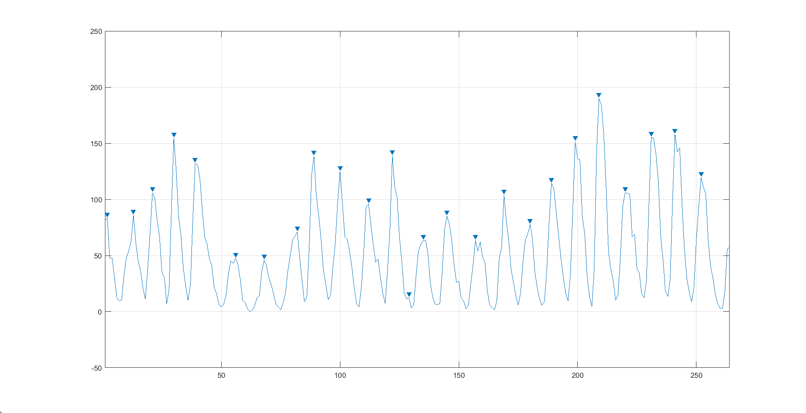
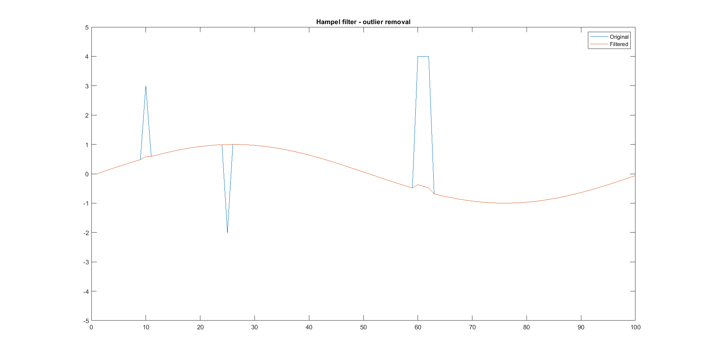
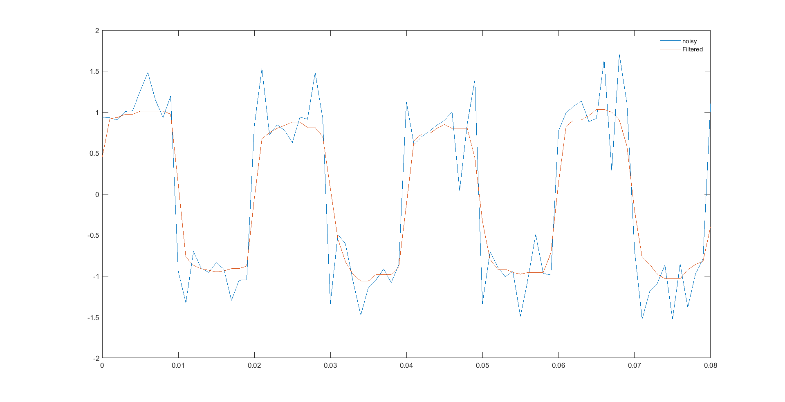

# Signal Processing with MATLAB

The code files and manuals on signal processing lab can be found in this repository. For details - https://www.asifnewaz.com/teaching/signal-processing-with-matlab

## Topics

This lab covers the following topics -

* Signal generation and visualization
* Peak analysis
* Filter operation - Median filter, Hampel filter
* Measuring signal similarities
## Recorded Lectures
For a video demonstration and discussion of the codes, check the YouTube video -

## Additional Content
For an introduction to digital image processing, see [02 – Digital Image Processing](../02-digital-image-processing/). For the full course, see the [main README](../README.md).

## Screenshots

