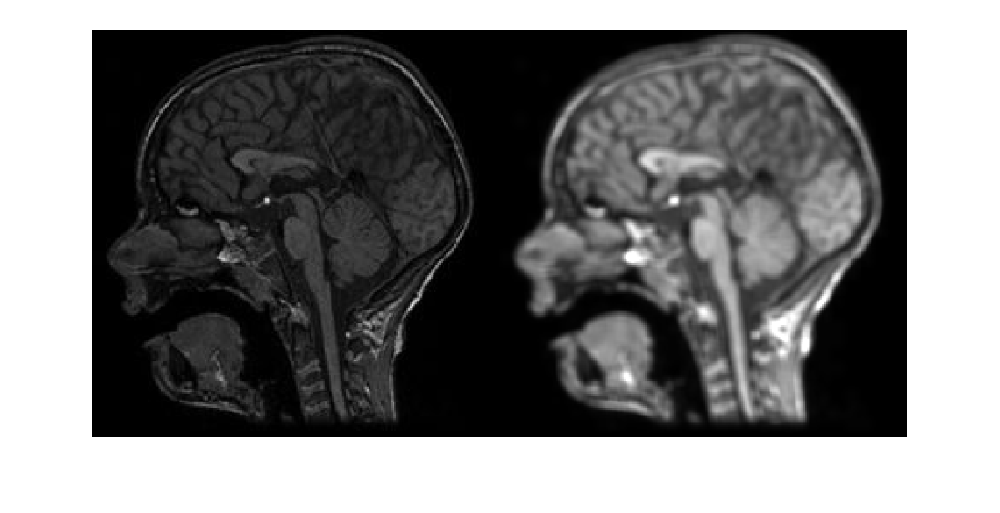
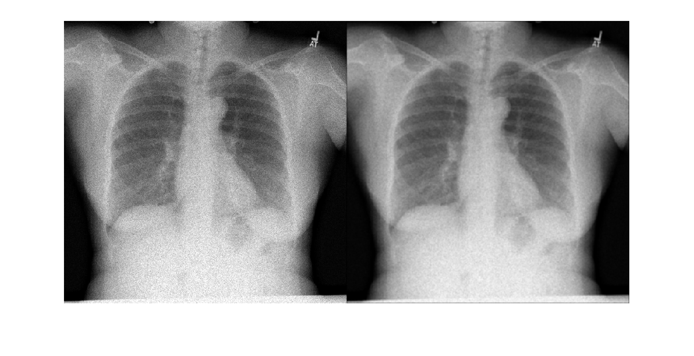

# Biomedical Image Processing

This repository contains manuals and codes for biomedical image processing using MATLAB. 

## Topics

This lab covers the following topics -

* Image enhancement - contrast adjustment, gamma correction, histogram equalization, brightening or sharpening image.
* Adding noise to image - Gaussian noise, Poisson noise, Salt and Pepper noise
* Image Filtering - spatial filtering - Low pass filter, high pass filter, median filter, wiener filter
* Edge detection - Canny, Sobel, and LoG edge detection methods
* MATLAB image processing tools
## Recorded Lectures
For video demonstration and discussion of the codes, check the YouTube video -

## Additional Content
For an introduction to digital image processing, see [02 – Digital Image Processing](../02-digital-image-processing/). For the full course, see the [main README](../README.md).
## Screenshots

